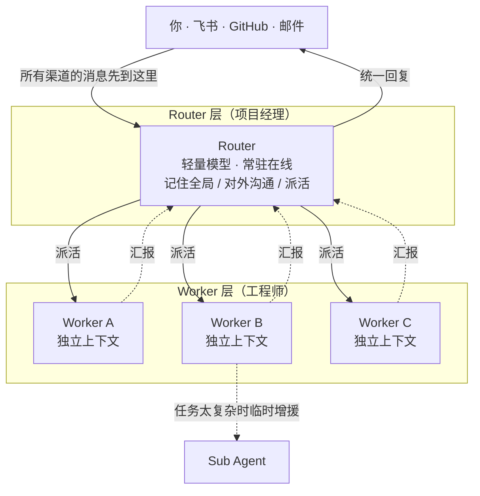
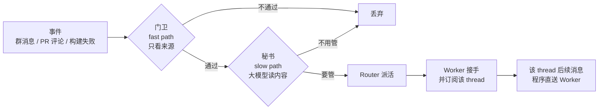
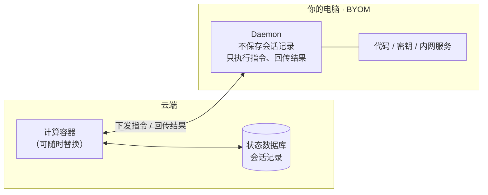

# Super Agent：把 Agent 从「一次会话」变成「一个团队」

> **一句话**：DeepSeek Harness 团队提出的 Super Agent，本质是把 Agent 和单次会话解绑——让它变成一个**跨会话记上下文、能同时推进多件事、互不干扰、常驻在线**的连续工作者。
>
> 结构上就两句话：**上层 Router 当项目经理，下层 Worker 当工程师。**

---

## 0. 30 秒速览

| 项目 | 内容 |
| --- | --- |
| 提出者 | DeepSeek Harness 团队（已开源研究原型） |
| 要解决的问题 | 单会话 Agent 撑不住多任务；人被迫在多会话之间当「传话筒」 |
| 核心动作 | **Agent 与 session 解绑**，从「任务驱动」改为「事件驱动」 |
| 架构骨架 | Router 层（项目经理）+ Worker 层（工程师）+ Trigger 过滤 + Watchdog |
| 实测收益 | 比传统单对话 Agent **快约 2 倍**，且更稳定 |
| 实测代价 | 读缓存 token 是单会话方案的 **2 倍 ~ 近 4 倍** |
| 最大风险 | 越主动 = 接触越多不可信信息；**提示词注入**是最大的一道坎 |

---

## 1. 现状：现在的 Agent 是怎么干活的

不管是 Claude Code、Codex 还是 DeepSeek Harness，主流 Agent 都以**会话（session）**为单位：

```
开一个会话 → 布置一个任务 → 想一步、做一步、看结果 → 再想下一步 → 做完收工
```

这个循环叫 **ReAct Loop**。单任务场景下它很好用，所以流行了很久。

### 问题出在「同时有好几件事」的时候

你开一个会话修 bug、一个写文档、一个跑测试，群里同事又说「这个需求改一下」，于是再开一个会话。

这些会话**互相不知道对方在干什么**，所有跨任务的信息只能靠你自己记住、再手动搬运。

> 不知不觉，你成了一群 AI 之间的传话筒。

DeepSeek 的观察非常直接：

> **单任务的上限取决于模型能力，多任务的上限取决于人的注意力。**

一个人通常只能同时跟进 **3 ~ 5 个**活跃会话。AI 越来越能干，人反而越来越累。

### 那让 Agent 自己接飞书消息呢？

借助 CLI + MCP 确实能做到，但只要底层还是单个会话，马上撞上三堵墙：

| # | 问题 | 表现 |
| --- | --- | --- |
| 1 | **阻塞** | 执行耗时命令时整个循环卡住，命令不跑完就处理不了新消息 |
| 2 | **串味** | 好几个需求塞进同一个会话，上下文越来越乱 |
| 3 | **掉线** | Agent 跑在你本地电脑上，电脑一休眠它就罢工 |

所以结论是：必须要**解绑**。

---

## 2. 定义：Super Agent 是什么

> 传统 Agent 是**一次只能干一件事的外包**；
> Super Agent 是**一个配合默契的项目团队**——团队里有很多人，但你只需要和一个对接人打交道。

### 四个基础特征

| 特征 | 含义 | 具体表现 |
| --- | --- | --- |
| **连续** | 跨渠道、跨会话不失忆 | 在飞书群里说用方案 A，后来在 PR 里改成方案 B，它能跟上 |
| **高效** | 多任务并发 | 上一件没干完，也能接下一条指令 |
| **主动** | 事件驱动而非等人催 | 自己盯群消息和工单，该处理的处理，不该管的保持安静 |
| **持久** | 常驻在线 | 一直在线，出了问题还能自己恢复 |

### 两个真实运行案例

1. **需求闭环**：用户在群里提「正文、代码、终端的字体希望分开配置」→ 维护者 @ 了一下 Super Agent → 它到 GitHub 提交改进代码 → 根据群里的追问和 PR 上的建议持续迭代 → **一路推进到代码合并**。
2. **自主发现 bug**：从产品用户群里识别出 bug 反馈 → 后台自主复现 → 找到根因 → 直接发出修复代码 + 前后对比截图。**全程没人催。**

---

## 3. 总体架构：一个项目经理 + 几个工程师

要同时处理二十件事，两种极端都不可行：

- 全交给一个人 → 信息不断，但只能**排队**做；
- 每件事找个新人 → 能同时开工，但**互不同步**，最后一人一嘴来找你汇报。

现实中的团队早就给出了答案：**招一个项目经理，再配几个工程师。**



**这个设计的关键点：**

- 你面对的**始终是同一个对接人**，团队内部怎么分工你根本不用关心。
- Router **不亲自干活**，只负责沟通和派活 → 所以**轻量模型就够**。
- 真正决定交付质量的是 Worker → **最强模型配给 Worker**。
- Worker 之间**一般不直接沟通**；如果两个 Worker 在改同一个 PR，会同时收到该 PR 的新动态，**自己就能协调好**。
- Worker 还能再拉几个 Sub Agent 帮忙——相当于**工程师自己带了实习生**。

### Router 会不会被消息淹死？

实践发现压力不大：Router 处理上一批消息时，新消息会先**攒着**，等它忙完再一起看、一起派活。

> 采用批处理机制后：**消息越多，平均处理反而越快。**

（典型的吞吐换延迟：牺牲单条消息的即时性，换整体处理效率。）

---

## 4. 从「你说一句」到「事件驱动」

传统 Agent 是你说一句才干一次活。Super Agent 由**环境里发生的事**驱动，DeepSeek 把这些事件统称为 **Trigger（触发事件）**：

- 群里来了新消息
- PR 下有人评论
- 代码构建失败

### 但群里的废话太多了

如果每条消息都丢给大模型判断要不要管，**又慢又烧钱**。DeepSeek 的做法是**两级过滤**：



| 角色 | 判据 | 用什么做 | 成本 |
| --- | --- | --- | --- |
| **门卫**（fast path） | 消息**从哪儿来**：是不是监听的群？发信人在不在白名单？ | 普通代码 | 秒级、几乎为零 |
| **秘书**（slow path） | 消息**说了什么**：按提示词里写好的规则判断要不要处理 | 大模型 | 高，但只处理门卫放行的少量消息 |

这就是计算机系统里的 **快慢路径（fast path / slow path）** 思想：**便宜但粗的判据先挡，贵但准的判据后置。**

---

## 5. Thread 订阅：让项目经理不必当二传手

消息过滤完要派活，但如果每条后续消息都要经过 Router 转一手，Router 又会成为瓶颈。

现实中的团队怎么做？一个工单第一次进来，经理分给小王；**之后这个工单的消息直接抄送小王。**

Super Agent 照搬了这个做法：

> **同一个 PR、同一个群话题、同一串邮件里的连续消息 = 一个 Thread（工单）。**

Worker 接手后**订阅**这个 thread，后续新消息由程序**直接送到他手上，不再经过 Router**——能省下大量 token。

---

## 6. 上下文：给干活的人看多少资料

给多了，重点被淹没；给少了，干活的人反复回头来问。

> **浪费上下文窗口，就是浪费模型的智能。**

DeepSeek 借用了编译器里的两个概念：

| 概念 | 出处 | 类比 | 做法 |
| --- | --- | --- | --- |
| **Inline（内联）** | 编译器把函数体直接展开 | 同事转消息时顺手附上前几句聊天和相关工单号，让你一眼看懂来龙去脉 | 把紧邻的、强相关的信息直接塞进去 |
| **Spill（溢出）** | 编译器把放不下的代码挪到别处 | 几万字的文档只给摘要 + 「完整内容见这里」，需要时再翻 | 大块内容只留摘要与引用 |

### 链式召回 Chain of Recall

系统给**每条消息、每个工单、每个 Worker 都编了号**，每张卡片上只写**摘要 + 关联编号**。

你跨平台提起一件旧事时，Router 不需要把历史记录全背下来，**顺着编号一路往下翻就行**——像侦探顺着线索查案。

---

## 7. 主动，但不乱来

### 投机执行（Speculative Execution）

CPU 在不确定某段计算会不会用上时，会**先提前算好**：用上了就赚，用不上就扔掉。

Super Agent 把它用在干活上：收到一封会议邀请，它先在后台核对日程、查好背景资料、备好回复草稿——**你确认一下就能直接发。**

### 主动的边界

> 主动 ≠ 乱来。

- 在开源原型里，**没人要求的主动工作**必须有团队**提前写好的规则**才允许做；
- 默认先跑**观察模式**：只记录自己打算做什么，**并不真的动手**；
- 等你确认它的判断靠谱了，再放开。

---

## 8. 全双工：把对讲机换成电话

传统 Agent 一干活就「听不见」新消息，根因是 **ReAct Loop 是半双工的**——像对讲机，同一时间只能一方说话。

Super Agent 要做的是**全双工**：

```
把耗时的工具调用改成异步
→ 命令一启动就立刻返回
→ Agent 继续跟你聊天
→ 命令跑完，结果作为一条新消息送回来
```

> 注：这个机制在很多 AI 工具里其实已经实现了，不算新发明。

### 不同渠道，不同说话方式

冗长的推理过程被**关在 Worker 里**，对外说话的只有项目经理，而且分渠道定了规矩：

| 渠道 | 规则 |
| --- | --- |
| 飞书 | 只在**需要你拍板**时才发消息；单次回复**不超过 100 词** |
| GitHub / 邮件 | 写清楚**问题背景、改动内容、验证结果** |

---

## 9. 常驻在线：存算分离 + BYOM

现在的本地 Agent 把三样东西绑在同一台电脑上：

```
① 负责干活的计算   ② 会话记录等状态   ③ 代码 / 工具等执行环境
```

电脑一休眠，三样全停摆，Agent 就下班了。

DeepSeek 借**存算分离**的思想，分两步拆开。

### 第一步：计算 ↔ 状态

像靠谱的团队会把工作记录放进档案室，谁来接班都能接着干。

- **计算**：放在云端**可随时替换的容器**里；
- **状态**：存进**数据库**；
- 容器挂了换一个就行，**记录一条都不会丢**。

### 第二步：计算 ↔ 执行环境

Agent 上了云，但它要用的代码、密钥、内网服务还都在你的电脑上，**搬不动**。

> 既然环境搬不动，那就别搬了。

**大脑留在云端，电脑上只装一个很轻的 Daemon。**



**BYOM = Bring Your Own Machine（带上你自己的电脑）**

Daemon 只负责按云端指令执行命令、回传结果——**像一个远程专家在指挥现场的助手**。

即使笔记本今天没开机，等它重新上线，云端也会自动把该在这台电脑上做的事补完。

---

## 10. Watchdog：值班主管

Agent 一直在线了，万一干着干着出问题呢？

DeepSeek 在主系统**外面**单独配了一个 Watchdog 会话——相当于**值班主管**，定时巡查。

关键在于它**看什么**：

- 不光看员工**在不在岗**（进程活没活）；
- 更要看任务**有没有进展**。

> 因为 Agent 出问题，很多时候程序并没有挂，而是**模型在原地打转或者跑偏了**。

发现异常就及时介入修复。

---

## 11. 代价：数字说话

| 指标 | 结果 |
| --- | --- |
| 速度 | 相比传统单对话 Agent **快约 1 倍**（即约 2×） |
| 稳定性 | 更稳定 |
| 读缓存 token | 是单会话方案的 **2 倍 ~ 近 4 倍** |

原因不难理解：同时维护多个会话、多个 Worker 各自的上下文，**token 开销必然上升**。

**有利有弊——省下的是人的注意力，付出的是 token 账单。**

---

## 12. 四个开放问题

DeepSeek 自己也坦诚地把这些问题摆了出来：

| # | 问题 | 本质 |
| --- | --- | --- |
| 1 | 任务规模继续变大，**一个项目经理还够用吗**？连续跑几个月，长期记忆怎么办？ | 扩展性 + 长期记忆 |
| 2 | 不再盯着会话之后，**人该用什么方式跟 Agent 协作**？聊天窗口还是最好的界面吗？ | 人机交互范式 |
| 3 | 每个人的**私人助理**和团队共用的 Super Agent 之间，如何在不泄露隐私的前提下配合？ | 隐私边界 |
| 4 | Agent 越主动，接触的**不可信信息**就越多，被**提示词注入**攻破怎么办？ | 安全 |

### 我的判断

> **安全是 Agent 工作最大的一道坎。**

就问一句：**你敢不敢让 AI 全天 24 小时盯着群聊、操作你的电脑？**

万一来了条恶意消息把 AI 忽悠了，你的数据和隐私怎么办？——这不只是 Super Agent 的问题，是**所有「主动型 Agent」共同的软肋**。

但整体仍然看好这个方向：它**把一套成熟的团队管理方法搬进了 AI 的世界**——项目经理、工程师、工单、值班主管、档案室，全是现实组织里验证过的东西。

---

## 附：术语速查

| 术语 | 中文 | 在这套架构里指什么 |
| --- | --- | --- |
| ReAct Loop | 推理-行动循环 | 想一步、做一步、看结果的单会话工作方式 |
| Router | 路由层 / 项目经理 | 常驻在线、记全局、对外沟通、派活；用轻量模型 |
| Worker | 工作层 / 工程师 | 独立上下文、专心干一件事；用最强模型 |
| Sub Agent | 子代理 / 实习生 | Worker 在任务复杂时临时拉来的帮手 |
| Trigger | 触发事件 | 群消息、PR 评论、构建失败等环境事件 |
| Fast path / Slow path | 快慢路径 | 门卫用代码秒判来源，秘书用大模型读内容 |
| Thread | 工单 / 话题串 | 同一 PR、同一群话题、同一串邮件；Worker 可订阅 |
| Inline | 内联 | 相关信息直接附上，省去来回追问 |
| Spill | 溢出 | 大块内容只留摘要 + 引用 |
| Chain of Recall | 链式召回 | 消息/工单/Worker 统一编号，靠编号逐层回溯 |
| Speculative Execution | 投机执行 | 提前把可能的活干好，用得上就赚 |
| BYOM | 带上你自己的电脑 | 云端大脑 + 本地轻量 Daemon |
| Watchdog | 看门狗 / 值班主管 | 独立会话定时巡查，看任务是否有进展 |

---

## 诚实清单

- **「五个模块」的具体划分**：原文提到「拆成五个模块」，但未逐条点名。本文按原文叙述整理为：双层架构（Router/Worker）、事件触发与两级过滤、上下文管理、全双工异步、存算分离与 BYOM、Watchdog。若与原论文的模块边界不一致，以原论文为准。
- **性能数字**：文中「快约 2 倍」「缓存 token 2×~近 4 倍」均来自原文转述的 DeepSeek 对比测试，本文**未独立复现**；也没有原始测试条件（任务类型、模型规模、并发度）。
- **「消息越多平均处理越快」**：原文的定性描述，未给出具体吞吐/延迟曲线，不能当作线性或单调结论使用。
- **架构图**（三张 mermaid）为依据文字描述绘制的示意，非原论文配图；Router/Worker 的通信方向、Sub Agent 的挂载位置做了简化。
- **案例细节**（字体配置需求、自主修 bug）来自原文叙述，本文未核实对应的公开 issue/PR 链接。
